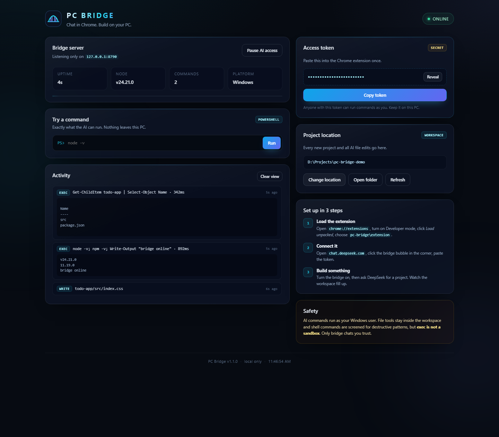

<p align="center">
  
</p>

<h1 align="center">PC Bridge</h1>
<h3 align="center">Chat with AI. Build on your real PC.</h3>

<p align="center">
  A local-only bridge between a logged-in AI chat in your browser and your computer.<br>
  The AI writes a command or file inside a fenced <code>bridge</code> block; the extension
  executes it through a token-protected localhost server and posts the result
  back into the chat automatically.
</p>

<p align="center">
  <a href="https://www.microsoft.com/windows"></a>
  <a href="https://nodejs.org/"></a>
  <a href="LICENSE"></a>
  <a href="#security"></a>
  <a href="https://github.com/INFINITY-BROZY/pc-bridge/actions/workflows/ci.yml"></a>
  <a href="https://github.com/INFINITY-BROZY/pc-bridge/stargazers"></a>
</p>

<p align="center">
  <a href="docs/INSTALL.md"><strong>Install guide</strong></a>
  ·
  <a href="docs/ARCHITECTURE.md">How it works</a>
  ·
  <a href="docs/PROTOCOL.md">Protocol</a>
  ·
  <a href="docs/TROUBLESHOOTING.md">Troubleshooting</a>
</p>

<p align="center">
  
</p>

---

## What it does

You talk to DeepSeek (or another supported chat) like normal. When the AI needs
your PC, it emits a structured block:

```bridge
{"tool":"exec","command":"npm install","cwd":"my-app","timeout":300}
```

PC Bridge runs it, captures stdout/stderr, and sends the result back as the next
chat message. The model keeps working until the project is built, tested, and
finished.

```text
┌─────────────────────────┐
│  Chrome: AI chat tab    │
│  chat.deepseek.com      │
└────────────┬────────────┘
             │ fenced bridge command
             ▼
┌─────────────────────────┐        token + CORS        ┌──────────────────────┐
│  PC Bridge extension    │ ─────────────────────────► │  127.0.0.1:8787      │
│  content script + UI    │ ◄───────────────────────── │  Node.js server      │
└────────────┬────────────┘        JSON result         └──────────┬───────────┘
             │                                                    │
             └──────── result posted into chat ──────────  PowerShell / files
```

**No cloud relay. No account. No open port.** Everything stays on your machine.

## Why PC Bridge

Chats can write code. They cannot install it, run it, read the error, and fix it.
PC Bridge gives the model hands on the machine that actually does the work:

- **It finishes the job.** Installs dependencies, runs builds, reads compiler
  errors, patches them, and keeps going until the app runs.
- **Your files stay yours.** Projects are written to your disk. No cloud
  sandbox, no file upload, no hosted workspace.
- **Nothing is exposed.** The server listens on loopback only, requires a random
  token, and allowlists its own origin.
- **You keep the keys.** Approve commands one by one, pause everything with one
  click, or point the bridge at a different project folder at any time.
- **Tiny and auditable.** One Node.js file with zero runtime dependencies, one
  readable Manifest V3 extension, and a local dashboard.

## Features

- **Real local execution** — PowerShell commands, npm/npx, git, builds, tests.
- **File tools** — read, write, list, move, remove, stat, and open folders.
- **Automatic loop** — results are posted back to the chat without copy/paste.
- **Changeable project location** — choose any folder from the dashboard or panel.
- **Approval mode** — optionally approve every command before it runs.
- **Pause switch** — stop AI access instantly from the panel or dashboard.
- **Command log** — full output stored under the workspace for inspection.
- **Multi-site, best effort** — DeepSeek is the primary target; ChatGPT, Claude,
  Gemini, and Grok adapters are included.
- **Zero dependencies** — the server uses only Node.js built-ins.

## Supported chat sites

| Site | Status | Default selectors |
| --- | --- | --- |
| [DeepSeek](https://chat.deepseek.com) | Primary, tested | `.ds-markdown`, `textarea` |
| [ChatGPT](https://chatgpt.com) | Best effort | auto |
| [Claude](https://claude.ai) | Best effort | auto |
| [Gemini](https://gemini.google.com) | Best effort | auto |
| [Grok](https://grok.com) | Best effort | auto |

Site redesigns can break UI automation. Use **Advanced → selectors** in the
panel or open an issue with the new selectors.

## Requirements

- Windows 10 or 11
- A Chromium browser: Chrome, Edge, Brave, Opera, or Vivaldi
- [Node.js](https://nodejs.org/) **20 or newer**
- A logged-in supported AI chat account

## Browser support

The extension is Manifest V3 and loads unpacked in any Chromium browser. The
dashboard itself works in every modern browser.

| Browser | Status |
| --- | --- |
| Google Chrome | ✅ Fully supported and tested |
| Microsoft Edge | ✅ Supported — use `edge://extensions` |
| Brave, Opera, Vivaldi | ✅ Supported — same Chromium engine |
| Firefox | 🚧 On the roadmap — needs a Firefox manifest |
| Safari | ❌ Not supported |

## Quick start

```text
1. Install Node.js 20+ and download this repository.
2. Double-click SETUP.bat.
3. In the extension page: Developer mode → Load unpacked → extension folder.
4. Open your AI chat, click the bridge bubble, paste the token, Connect.
5. Flip Bridge on and ask for a project.
```

`SETUP.bat` starts the server, opens the correct extension page for Chrome or
Edge, and opens the `extension` folder for you. After the first run, just use
`START-BRIDGE.bat`.

The dashboard opens at **http://127.0.0.1:8787**. The first server start creates
`server/config.json`, `server/token.txt`, and `workspace/`.

> **Read the full [installation manual](docs/INSTALL.md) before your first run.**
> It covers token setup, folder loading, the first verified command, changing
> the project location, updating, and uninstalling.

## First project prompt

```text
Build me a modern React todo app in a folder called todo-app.
Use dark mode, make it responsive, install everything, and run a production
build to verify it works. Do not stop until the build passes.
```

The AI should reply with **BRIDGE READY** after the initial verification, then
start emitting one bridge block at a time.

## Project location

Projects are created in `workspace/` by default. Change it from either place:

- **Dashboard → Project location → Change location**
- **Bridge panel → Project location → Save location**

The folder is created if missing, stored in `server/config.json`, and all file
tools plus command working directories move with it. Existing projects are not
moved. Use **Update this chat** in the panel so an already-open conversation
learns the new path.

## Security

PC Bridge is a **power tool**, not a sandbox.

- The server binds to `127.0.0.1` only and requires a 48-character token.
- File tools are confined to the configured workspace; `..` escapes are rejected.
- The token is generated locally and stored in `server/token.txt` (git-ignored).
- Shell commands are screened for a small set of catastrophic patterns, but the
  AI still runs with **your Windows permissions**.
- Use **Auto-run off** to approve each command, and **Pause AI access** as a kill
  switch.
- Treat AI output as untrusted. Prompt injection in a webpage, repository, or
  dependency can try to turn a trusted chat into an attacker.

**Never expose port 8787 to the internet and never commit `server/token.txt`.**
See [SECURITY.md](SECURITY.md) for the full threat model.

## Repository layout

```text
pc-bridge/
├── SETUP.bat                 # first-run: server + extension page + folder
├── START-BRIDGE.bat          # start the local server
├── INSTALL-EXTENSION.bat     # open chrome://extensions + extension folder
├── extension/                # load this folder as an unpacked extension
│   ├── manifest.json
│   ├── background.js         # proxies API calls to 127.0.0.1
│   ├── content.js            # chat watcher + execution loop
│   ├── adapters.js           # site-specific DOM adapters
│   ├── shared.js             # protocol parser + prime message
│   └── ui.js                 # in-page control panel
├── server/
│   ├── server.js             # HTTP API, tools, and safety checks
│   ├── config.example.json   # documented defaults
│   └── public/               # local dashboard
├── dev/                      # mock chat page for offline testing
├── docs/                     # install, architecture, protocol, help
├── scripts/                  # repository maintenance scripts
└── tests/                    # dependency-free smoke tests
```

Runtime-only files (`server/config.json`, `server/token.txt`, `logs/`,
`workspace/`) are deliberately git-ignored.

## Development

```powershell
npm run check     # syntax-check every JavaScript file
npm test          # start an isolated server and exercise the API
npm run dev       # start the server without opening a browser
```

Mock-chat mode (no AI account needed):

```powershell
$env:PC_BRIDGE_DEV = "1"
$env:PC_BRIDGE_PORT = "8788"
npm run dev
# open http://127.0.0.1:8788/mock
```

See [CONTRIBUTING.md](CONTRIBUTING.md) for architecture notes and pull-request
guidelines.

## Troubleshooting

The short version: restart `START-BRIDGE.bat`, click **Connect**, then
**Re-send protocol**. For everything else, see
[docs/TROUBLESHOOTING.md](docs/TROUBLESHOOTING.md).

## Star the project

If PC Bridge saves you an evening of copy-pasting, a ⭐ helps other people find
it. That is the whole marketing budget.

## Disclaimer

PC Bridge is an independent project, not affiliated with DeepSeek, OpenAI,
Anthropic, Google, or xAI. Automating a website may be subject to that site's
terms of service. Use your own account, your own machine, and your own
judgement. You are responsible for commands you allow the AI to run.

## License

[MIT](LICENSE) © 2026 PC Bridge contributors
